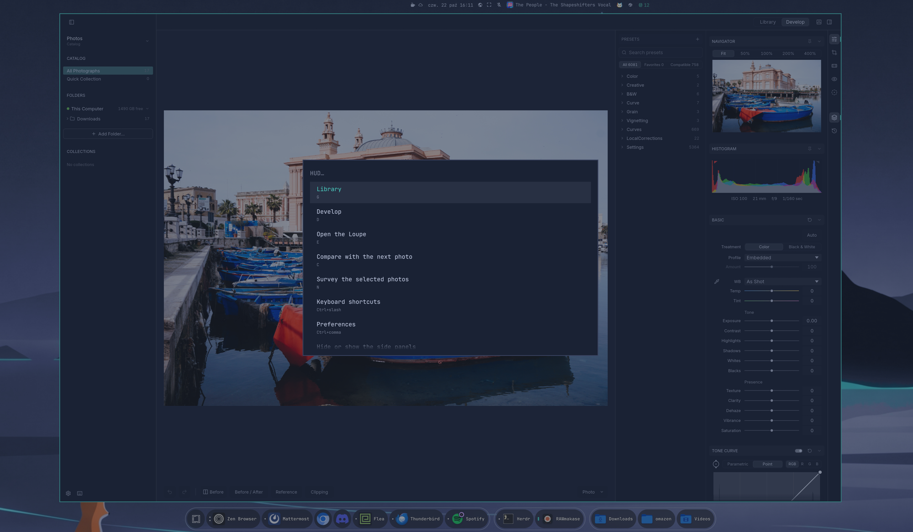

# omarchy-hud

A Unity-style HUD for [Omarchy](https://omarchy.org): press a key on any window, fuzzy-search
the commands from that app's menus, hit Enter to run one.

> **Proof of concept.** This is an experiment in what a HUD on Omarchy could look like, built
> in a couple of days. It works on the author's machine every day, but it leans on Omarchy
> internals (the menu's private payload, Hyprland's Lua dispatchers) that can change under it.
> Not affiliated with Omarchy.



It reads menus straight from D-Bus (`org.gtk.Menus`, `org.gtk.Actions`,
`com.canonical.dbusmenu`), finding the focused app's connections by PID, so it needs
no Hyprland plugin and no app changes. Media players get their MPRIS playback controls,
and apps with no exported menu (browsers, Thunderbird, Omarchy's own apps, RAWmakase) get commands
from shortcut packs that send the app's own key chords. It is a single Rust binary that lives only while
the menu is open: about 6 ms and 3 MB of RAM to collect a menu of 150 commands.

## Where the idea comes from

Ubuntu 12.04 shipped [Unity's HUD](https://en.wikipedia.org/wiki/Unity_(user_interface))
in 2012: tap Alt, type what you want, and run any command from the focused app's menus without
hunting through them. It went away with Unity in 2017, while the same idea won everywhere else
as the command palette (Sublime Text, VS Code, KDE's `KCommandBar` on Ctrl+Alt+I, the
[Plotinus](https://github.com/p-e-w/plotinus) palette for GTK). Omarchy is keyboard-first and
already has a fast fuzzy menu, so the missing piece was getting the commands out of the apps.
Most Linux apps still describe their menus on D-Bus for global menus, which is where this
starts; for the apps that don't, see [making an app work with the HUD](docs/integration.md).

## Status

| Toolkit | Works | Notes |
|---|---|---|
| GTK3/GTK4 apps with a menubar (Xournal++) | yes | full labels and shortcuts |
| LibreOffice | yes | its GTK3 menubar, per window |
| GTK apps without a menubar (Nautilus, Evince) | yes | labels and translations read from the app's built-in menus; the rest from action names |
| Qt and KDE apps (OBS, Kdenlive) | opt-in | needs the registrar service, which hides their in-window menubars; see below |
| Firefox, Zen, Chromium, Thunderbird, Flea, RAWmakase | shortcut packs | their own keyboard shortcuts, sent to the window; see below |
| Media players (Spotify and anything with MPRIS) | playback | Play/Pause, Next, Previous, Stop, next to the app's own menu |
| Apps that export the HUD's own command list | yes | see [docs/integration.md](docs/integration.md) |
| Other Electron apps, terminals | no | they export no menus on Wayland; add a shortcut pack |

## Install

Needs Rust (`pacman -S rust`) to build; at runtime only libdbus, which every Omarchy system has.

```bash
cargo build --release
ln -s "$PWD/target/release/omarchy-hud" ~/.local/bin/omarchy-hud
```

Bind it in `~/.config/hypr/bindings.lua` (`SUPER + ALT + SPACE` is taken by Omarchy):

```lua
o.bind("SUPER + ALT + M", "HUD", "omarchy-hud")
```

### Menu over the window

Omarchy's menu always opens in the middle of the screen, which on a wide monitor can be far
from the window the commands are for. `dist/menu/install` installs `omarchy-hud.menu`, a copy
of Omarchy's menu plugin with [one small patch](dist/menu/menu-anchor.patch) that centers it on
a given rectangle; the HUD then opens over the focused window. Only the HUD uses it, Omarchy's
own menu is left alone, and without it the HUD falls back to Omarchy's menu.

```bash
dist/menu/install              # again after an Omarchy update, to follow its menu
dist/menu/install --uninstall
```

The patch is proposed upstream; once Omarchy's menu takes an `anchor`, the copy can go.

### Qt and KDE apps

Qt exports its menus over D-Bus only if an AppMenu registrar is running when a window
opens. `omarchy-hud registrar` is one (0.7 MB, idle), shipped as a systemd user unit:

```bash
systemctl --user link "$PWD/dist/omarchy-hud-registrar.service"
systemctl --user enable --now omarchy-hud-registrar
```

Restart Qt apps afterwards. **The trade-off:** with a registrar running, Qt and KDE apps
hide the menubar inside their windows, as under Unity or Plasma's global menu, so the HUD
becomes the way into their menus. Qt offers no switch to keep both. Omarchy's default
`QT_QPA_PLATFORMTHEME=gtk3` works as is. To undo:
`systemctl --user disable --now omarchy-hud-registrar` and restart the apps.

## Usage

```bash
omarchy-hud                      # menu for the focused window
omarchy-hud --list --pid 1234    # print the commands of a process
omarchy-hud --list --window 0x55e5787d28f0   # of a window, as in hyprctl clients
omarchy-hud --run "File › Save" --pid 1234
```

Commands you picked recently in an app come first, newest on top (kept in
`~/.local/state/omarchy-hud/recent`, 10 per app).

### Shortcut packs

Apps that export no menu get commands from shortcut packs: picking one sends the app's
own key chord to its window through Hyprland (`hl.dsp.send_shortcut`, after focusing the
window, since apps ignore keys while unfocused). Built-in packs live in [`packs/`](packs)
and are compiled into the binary. Add your own, or override a built-in line by its label,
in `~/.config/omarchy-hud/shortcuts/*.conf`:

```ini
# Sections name window classes, as in hyprctl clients.
[mattermost-desktop]
Find = Ctrl+K
Jump to unread channel = Alt+Shift+Up
```

Modifiers are `Ctrl`, `Shift`, `Alt` and `Super`; keys are xkb names (`T`, `F5`,
`Delete`, `equal`, `Page_Down`). Packs need a window, so `--pid` skips them. Apps can ship
their own pack in `/usr/share/omarchy-hud/shortcuts/`; see [docs/integration.md](docs/integration.md).

## Development

```bash
cargo test
cargo run --release --example bench -- 30 "$(pgrep -x xournalpp)" target/release/omarchy-hud
```

Test against live apps over D-Bus with `--list` and `--run`, never by simulating keystrokes.
For example, toggle a stateful action and read it back:

```bash
omarchy-hud --pid "$(pgrep -x xournalpp)" --run "View › Layout › Vertical"
gdbus call --session -d <unique-name> -o /com/github/xournalpp/xournalpp/window/1 \
  -m org.gtk.Actions.Describe set-layout-vertical
```

Labels follow the app's language, so use the ones `--list` prints.

## Performance

0.1.0 was a Python script (PyGObject) that showed its list through `omarchy-menu-select`.
0.2.0 is a Rust rewrite (`dbus` crate over libdbus, no async runtime) measured on 2026-10-22,
Omarchy 4.5.0rc1, Hyprland 0.56.2.

**Collecting the commands** (`--list`, median of 30 runs, from `rusage`, `examples/bench.rs`):

| App (commands) | Python 0.1.0: wall / CPU / peak RAM | Rust 0.2.0: wall / CPU / peak RAM |
|---|---|---|
| Xournal++ (148) | 127 ms / 88 ms / 31.6 MB | 5.8 ms / 3.2 ms / 3.2 MB |
| Nautilus (19) | 79 ms / 77 ms / 31.3 MB | 2.2 ms / 1.6 ms / 3.2 MB |
| Evince (11) | 128 ms / 80 ms / 31.1 MB | 4.4 ms / 2.6 ms / 3.4 MB |
| OBS, Qt (68) | 93 ms / 95 ms / 31.6 MB | 4.0 ms / 2.7 ms / 3.5 MB |

For scale, `/bin/true` peaks at 2.2 MB on the same machine.

**From launch to visible menu** (Xournal++, median of 10, polling `hyprctl layers`):
181 ms in 0.1.0, 27 ms in 0.2.0. Most of what is left is the Omarchy shell opening its
menu (about 20 ms, the same for 5 or 147 rows).

Where the time went, and what fixed it:

| Cost in 0.1.0 | Fix |
|---|---|
| Waiting 500 ms (0.1.0) or 50 ms (after the first fix) for app connections that never answer D-Bus | All connections are probed in one pipelined batch; once one answers, the rest get 2 ms. If that finds nothing, the cut ones get a second, patient try. |
| Python + PyGObject start-up, ~60 ms CPU, 31 MB | Rust binary, 0.8 MB, starts in about 1 ms |
| `omarchy-menu-select`: bash plus three perl runs to build JSON, ~45 ms | The payload is built in-process and sent with one `omarchy-shell` call |
| `hyprctl activewindow` spawn | Hyprland's socket is queried directly |
| One D-Bus round trip per name and per object | `GetConnectionUnixProcessID` and `Introspect` are pipelined, one batch per tree level |

0.3.0, apps added since (`--list`, median of 20): LibreOffice Writer (518 commands) 12 ms /
5.8 ms CPU / 3.7 MB, Kdenlive (630) 14.5 ms / 7.3 ms CPU / 4.2 MB. Most of that is the apps
answering; Kdenlive's menu is fetched twice because Qt fills dynamic submenus only on
AboutToShow and does not say which ones changed. The registrar idles at 0.7 MB.

0.4.0 (`--list --window`, median of 21): Thunderbird (28 pack commands) 2.4 ms / 2.0 ms CPU /
3.5 MB, Spotify (tray menu plus MPRIS) 4.9 ms / 3.2 ms / 3.4 MB, Zen (47 pack commands)
5.8 ms / 5.2 ms / 3.4 MB. Packs are compiled in, so only user packs cost a file read.

Lazy loading was considered and dropped: fuzzy search needs every command up front,
and fetching all 148 Xournal++ commands takes about a millisecond.

## License

MIT
